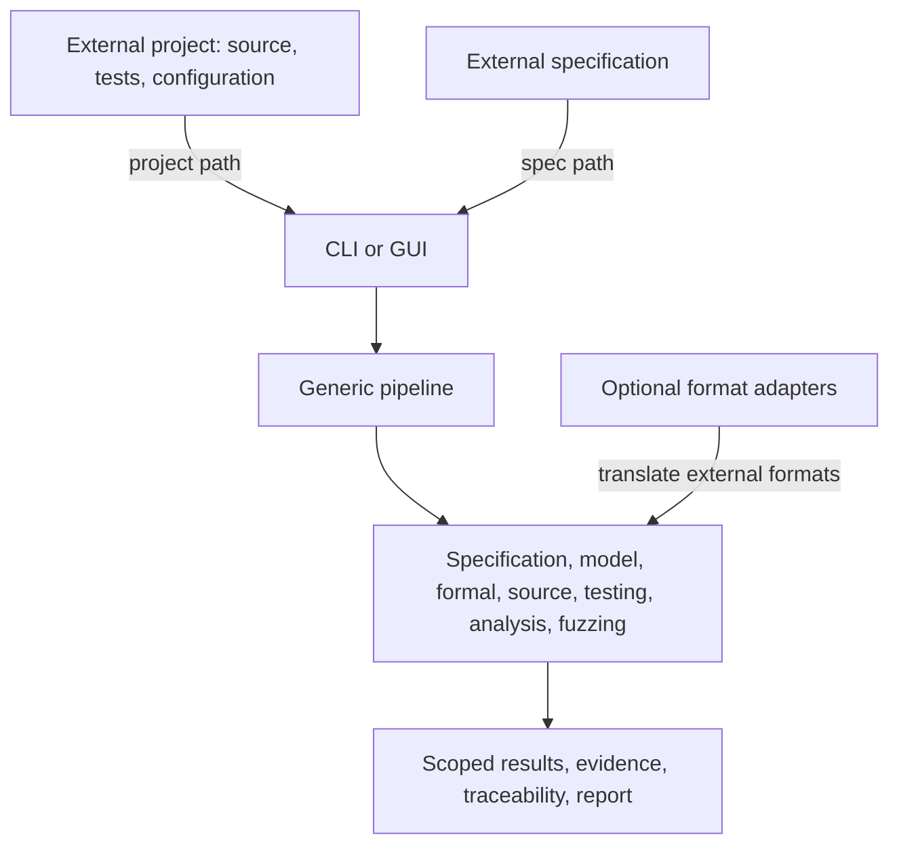

# Verification tool architecture and isolation

SecLab is an independent verification tool. It accepts a software project, one or more specification files, and optional generic pipeline configuration as inputs. The project under test (SUT) remains external and does not import or install SecLab.



## Generic core

The core under `src/seclab/` contains the specification contract and validator, Kripke model, CTL/SMT/BMC checkers, source discovery, execution and dynamic testing, static and memory analysis, coverage, fuzzing, result classification, evidence storage, traceability, and pipeline orchestration. These modules consume project and specification inputs through generic APIs. They do not identify a business domain or assume a particular repository layout beyond the configured project root.

## Optional integrations and dependency direction

`src/seclab/integrations/` contains optional adapters for external formats and fixtures. For example, `smart_ev_adapter.py` translates one external teacher JSON format into the generic specification contract. `smart_ev_probes.py` runs a separately scoped tool capability fixture. Generic core code does not import either module. Removing the integration package does not prevent generic project imports or pipeline runs.

The dependency direction is external input → CLI/GUI → pipeline → generic core APIs. Optional adapters translate external inputs into those APIs. No adapter is required by the core, and no SUT depends on SecLab.

## Input and output contract

Provide a project directory with source code and optional tests, a specification conforming to [`specification-format.md`](specification-format.md), and optional JSON pipeline configuration. The CLI records the project and specification inputs in run metadata/evidence. Source inventory and integrity artifacts include source paths and hashes; results refer to scoped stage/check outcomes and evidence IDs. The report does not synthesize an overall project verdict, score, or grade.

## Why a SUT stays outside the core

The verification tool must be useful when a SUT is absent, replaced, or in another domain. Keeping each SUT outside the core prevents its naming, business rules, source layout, and release lifecycle from changing generic specification, model, analysis, and reporting semantics. A format-specific adapter may map inputs, but it cannot silently add domain assumptions to a checker.

## Run the generic C fixture

From the repository root:

```powershell
python -m seclab.cli verify `
  --project examples/generic-c-project `
  --spec examples/generic-c-project/specification.json
```

The default evidence workspace is a sibling of the SUT directory. Set `--workspace` to choose another location. Use `--stage` to select a stage (with its prerequisites), and `--config` for a JSON object containing generic `PipelineOptions` values such as `static_analyzers`, timeouts, or coverage settings.

The independent [`generic-c-memory-project`](../examples/generic-c-memory-project/README.md) fixture exercises allocation, branches, function mapping, and a test oracle.

## Verify another project

Any project directory can be supplied without changing or copying it into SecLab:

```powershell
seclab verify --project <PROJECT_PATH> --spec <SPEC_PATH> --workspace <WORKSPACE>
```

Repeat `--spec` to provide a split specification bundle. Source selection, build flags, analyzer configuration, and stage options are inputs; no project name is used to select checker behavior.

## Integrating Smart-EV

Smart-EV is one external SUT. Point the generic CLI to its project and specification paths, or use the optional adapter to translate its external teacher format. The adapter and its explicit integration test are isolated under the integration layer and are opt-in; the generic fixture and generic unit tests do not require the Smart-EV repository. Standalone defect probes remain capability fixtures, carry `BUG_INJECTED_PROBE` scope, and do not support claims about production SUT vulnerabilities.
